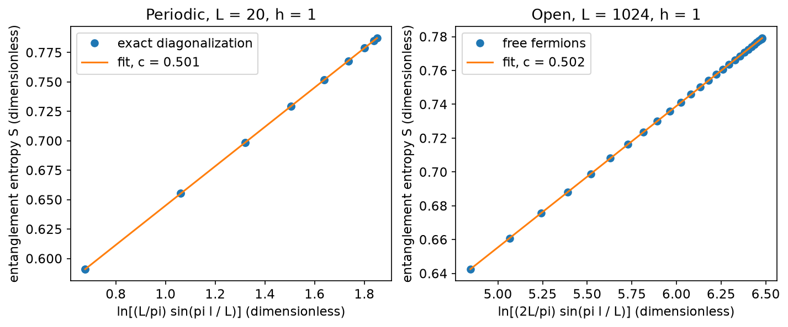
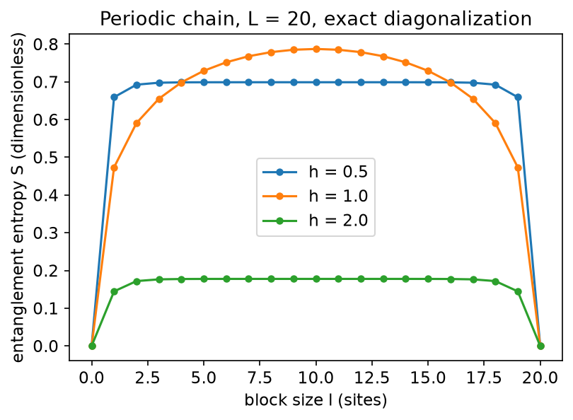
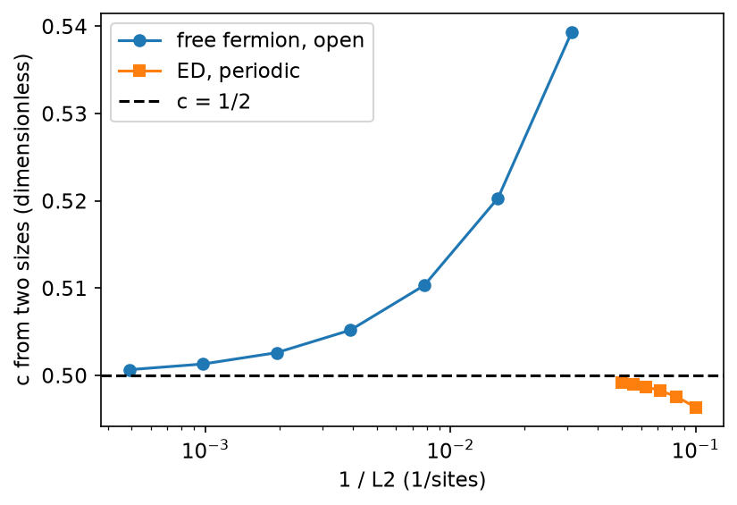
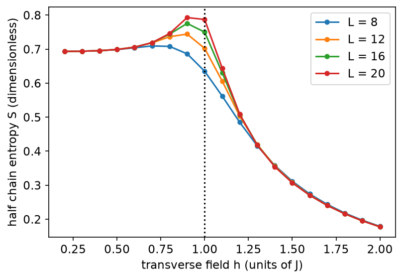
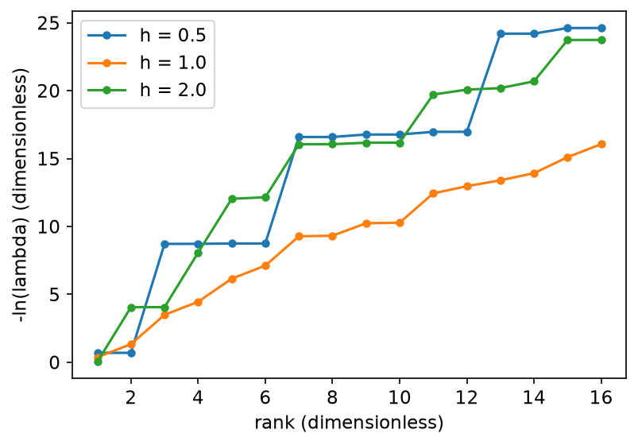

# Entanglement in the quantum Ising chain

I measure the central charge of the critical transverse field Ising chain from the entanglement entropy of its ground state. I use exact diagonalization up to 20 spins and an exact free fermion solution up to 2048 spins. The entropy of a block grows like the logarithm of the block size at the critical point, and the slope gives c. My main result is c = 0.5007, against the exact 1/2, with a finite size systematic of 0.0007.



## What this is

The model is the transverse field Ising chain of L spins with spin 1/2. I write it with the field along z:

```
H = -J * sum_i X_i X_{i+1}  -  h * sum_i Z_i        (J = 1)
```

The bonds run over i = 0 to L-2 for the open chain. The periodic chain has the extra bond between the last and the first site. For h < 1 the chain is ordered. For h > 1 it is disordered. The critical point is h = 1.

The entanglement entropy of a block is the von Neumann entropy S = -tr(rho ln rho) of the reduced density matrix of that block. It is zero for a product state and ln 2 for a Bell pair. Away from the critical point the entropy of a block saturates, which is the area law in one dimension. At the critical point it grows like the logarithm of the block size, and the slope is set by the central charge c.

The Calabrese and Cardy formulas for a block of l sites in a chain of L sites are:

```
periodic:                  S(l) = (c/3) ln[(L/pi) sin(pi l / L)] + const
open, block at one end:    S(l) = (c/6) ln[(2L/pi) sin(pi l / L)] + const
```

This basis is a Hadamard rotation on each site of the usual form -J sum Z Z - h sum X, and a local rotation does not change any bipartite entanglement, so every entropy here is the same as in the usual form.

The 1D quantum Ising chain and the 2D classical Ising model are in the same universality class, and both critical points are described by the same conformal field theory with c = 1/2. My Monte Carlo of the 2D model is in the Ising-Monte-Carlo repository.

## How to run it

I used Python 3.12.5.

```
python3.12 -m venv .venv
source .venv/bin/activate
pip install -r requirements.txt
```

Then, from the project folder with the environment active:

```
python -m pytest -q
python run_all.py --quick
python run_all.py
python make_figures.py
python check_consistency.py
```

The full run took about 124 seconds on my laptop. The quick run writes to `results_quick/` and takes under a minute. Everything runs offline. Nothing is downloaded and no account is needed.

## Method

Exact diagonalization. The parity P = product of Z_i commutes with H. For every h > 0 the ground state of a finite chain is in the even sector (P = +1), and the tests check that the even sector is the lowest. So I build the Hamiltonian only in the even sector, as a sparse matrix, and find the lowest eigenpair. The sizes go up to L = 20, where the even sector has 524288 states. A basis state is an integer, and site 0 is the most significant bit. The entropy comes from the singular values of the state reshaped into a matrix.

Free fermions. The Jordan-Wigner map turns the chain into Majorana fermions, and H becomes quadratic. I build the real antisymmetric matrix A, and the ground state covariance matrix is Gamma = -A (-A A)^(-1/2). The entropy of the first l sites comes from the eigenvalues of i Gamma restricted to those sites (Peschel, and Vidal and others). Only blocks that start at site 0 are used, because only for them the Majorana reduced state equals the spin reduced state. The chain is symmetric under reflection and the ground state is unique, so S(l) = S(L - l). I compute only l up to L/2 where I need a profile.

I use the free fermion code only for open chains with h >= 1. For h < 1 the open chain has an edge mode whose energy falls roughly exponentially with L. The code raises an error when the smallest mode energy is below 1e-6. That limit sits well above the rounding floor of about 1e-8, so the check does not depend on rounding. For example, it raises at h = 0.5 with L = 1024 and at h = 0.9 with L = 256. At h = 1 the smallest mode energy is still about 1.5e-3 at L = 2048.

Checking one method against the other. For open chains with L = 8, 12, 16, 20 and h = 1.0, 1.5, 2.0, the largest difference in entropy over all l is 7.9e-13 and the largest difference in ground state energy is 5.0e-14.

## Results

| Estimator | Sizes | c |
| --- | --- | --- |
| Two sizes, free fermion, open, h = 1 (main estimate) | L = 1024 and 2048 | 0.5007 |
| Two sizes, free fermion, open, h = 1 (previous doubling) | L = 512 and 1024 | 0.5013 |
| Fit of S(l), free fermion, open, h = 1 | L = 1024, l = 64 to 512 in steps of 16 | 0.5016 |
| Fit of S(l), exact diagonalization, periodic, h = 1 | L = 20, l = 2 to 18 | 0.5014 |
| Two sizes, exact diagonalization, periodic, h = 1 | L = 18 and 20 | 0.4992 |

The systematic is the absolute difference between the last two doublings of the main estimate. It is 0.0007.

The free fermion estimates move halfway closer to 0.5 with each doubling, so the error falls like 1/L. A Richardson extrapolation of the last two doublings, 2 x 0.5007 - 0.5013 with the unrounded values, gives 0.50000. This is a supporting estimate, not part of the plan in `PREREGISTRATION.md`.



Figure 1 shows the area law and the logarithm. At h = 0.5 and h = 2 the profile is flat in the middle. At h = 1 it keeps rising towards the middle of the chain.



Figure 3 shows c from pairs of sizes against 1/L2. The open chain approaches 0.5 from above. The periodic chain approaches it from below.



Figure 4 shows the half chain entropy against h for several L. It has a peak near h = 1, and the peak grows with L. For these small sizes the peak sits a little below h = 1 and moves toward it as L grows.



Figure 5 shows the 16 largest levels of the half chain entanglement spectrum. At h = 1 the levels are dense and start low. At h = 0.5 they come in degenerate pairs and groups, and at h = 2 the first level is far below the rest.

The pre-registered test passed. The main estimate is consistent with 1/2, because its distance from 1/2 is less than 3 times the systematic. This test is easy to pass: the error roughly halves with each doubling, so the distance from 1/2 and the systematic come out almost equal. The stronger evidence is figure 3, where both methods move steadily toward 0.5, one from above and one from below.

## What I checked

The test suite has 101 tests, and they all pass. They cover:

- The sparse Hamiltonian against a full Hamiltonian built from Kronecker products of Pauli matrices, for L = 2, 3, 4, both boundaries.
- The periodic ground state energy against the exact formula, for L up to 12.
- The even sector being the lowest in energy.
- The h = 0 cat state with entropy ln 2, and the large field product state.
- The free fermion energy and entropy profile against exact diagonalization for open chains up to L = 12.
- The covariance matrix properties, the single site case, and the near zero mode error at large L for h < 1 (and no error at h = 1).
- The entropy of product, Bell and random states, the bit order, and the reflection symmetry of ground state entropy.
- The fits of c on synthetic data.

## Limits

This reproduces a known exact result. The uncertainty is a finite size systematic and not a statistical error. Exact diagonalization stops at L = 20. The free fermion part covers only open chains with h >= 1. I study only ground states. I study only the von Neumann entropy.

## Plan written first

The plan is in `PREREGISTRATION.md`. The commit history here does not show this order, because I uploaded the finished project in a few commits.

## References

- P. Pfeuty, "The one-dimensional Ising model with a transverse field", Annals of Physics 57, 79 (1970).
- C. Holzhey, F. Larsen and F. Wilczek, "Geometric and renormalized entropy in conformal field theory", Nuclear Physics B 424, 443 (1994).
- G. Vidal, J. I. Latorre, E. Rico and A. Kitaev, "Entanglement in quantum critical phenomena", Physical Review Letters 90, 227902 (2003).
- P. Calabrese and J. Cardy, "Entanglement entropy and quantum field theory", Journal of Statistical Mechanics (2004) P06002.
- I. Peschel, "Calculation of reduced density matrices from correlation functions", Journal of Physics A 36, L205 (2003).

## License

MIT.
